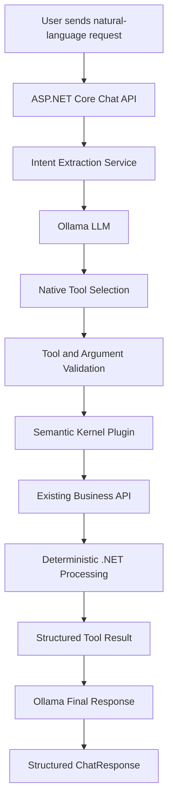



# SemanticKernelPlatform

### An extensible .NET GenAI integration platform powered by Microsoft Semantic Kernel and Ollama

[](https://dotnet.microsoft.com/)
[](https://learn.microsoft.com/en-us/semantic-kernel/)
[](https://ollama.com/)
[]()

## Overview

**SemanticKernelPlatform** is a .NET-based Generative AI integration platform designed to connect Large Language Models (LLMs) with existing business applications, APIs, and services.

The primary objective is to build an intelligent application layer that allows users to interact with existing business systems through natural language instead of manually navigating multiple APIs or application interfaces.

The platform uses **Microsoft Semantic Kernel** for AI orchestration, **Ollama** for running local open-source language models, and a hybrid AI + deterministic processing architecture to ensure that business operations remain accurate, controlled, and reliable.

Rather than allowing an LLM to independently process business-critical information, the application follows an important principle:

> AI understands the user's request. .NET executes business operations. Existing APIs remain the source of truth. AI explains the results when needed.

The project is being developed incrementally, with a focus on learning and implementing production-oriented GenAI application architecture.

## Key Objectives

- Integrate LLM capabilities into existing .NET applications and APIs.
- Build reusable AI-powered integrations for multiple business systems.
- Implement function calling and tool orchestration.
- Maintain accurate business results through deterministic .NET processing.
- Support conversational interactions with context awareness.
- Implement caching to reduce unnecessary API requests.
- Explore RAG, vector databases, and advanced AI orchestration.
- Build a foundation for enterprise-grade intelligent applications.

## Technology Stack

| Category | Technology |
|---|---|
| Backend | ASP.NET Core Web API |
| Framework | .NET 10 |
| AI Orchestration | Microsoft Semantic Kernel |
| LLM Runtime | Ollama |
| Local LLM | Qwen 2.5 3B |
| Language | C# |
| Architecture | Clean Architecture |
| HTTP Integration | HttpClient |
| Configuration | appsettings.json |
| API Documentation | Swagger / OpenAPI |
| Data Serialization | System.Text.Json |
| Dependency Injection | Microsoft.Extensions.DependencyInjection |
| Conversation Storage | In-memory implementation |

## Solution Architecture

The solution follows Clean Architecture principles to separate business abstractions, infrastructure implementations, AI plugins, and API responsibilities.

### Project Structure

```text
SemanticKernelPlatform
│
├── SemanticKernelPlatform.Api
│   ├── Controllers
│   ├── Program.cs
│   └── appsettings.json
│
├── SemanticKernelPlatform.Application
│   ├── Interfaces
│   ├── Models
│   └── Business Abstractions
│
├── SemanticKernelPlatform.Infrastructure
│   ├── Services
│   ├── Models
│   ├── Prompts
│   ├── Stores
│   └── DependencyInjection.cs
│
└── SemanticKernelPlatform.Plugins
    ├── Analysis
    ├── Http
    ├── Platform
    ├── PluginRegistry.cs
    └── tests
```

*The structure represents the main solution projects and areas; individual folders may evolve as development progresses.*

### Architectural Responsibilities

**1. SemanticKernelPlatform.Api**

- Exposes REST API endpoints.
- Handles incoming chat requests.
- Returns structured responses to clients.
- Provides Swagger documentation.

**2. SemanticKernelPlatform.Application**

- Contains application models and interfaces.
- Defines business-level abstractions.
- Maintains separation between application logic and infrastructure implementations.

**3. SemanticKernelPlatform.Infrastructure**

- Implements external API integrations.
- Handles Ollama communication.
- Manages chat history and conversation data caching.
- Implements AI-related application services.
- Loads and manages prompt templates.

**4. SemanticKernelPlatform.Plugins**

- Contains reusable Semantic Kernel plugins.
- Provides HTTP API integration functions.
- Provides platform information and analysis capabilities.
- Exposes business operations to the AI orchestration layer.

## Implemented Features

The following capabilities have been implemented during the current development phase.

### 1. Local LLM Integration

Integrated Ollama with the .NET application to run an open-source language model locally.

Current configuration:

- Provider: Ollama
- Model: Qwen 2.5 3B
- Endpoint: `http://localhost:11434`

The application communicates with the locally running model without requiring a hosted LLM API for the current inference workflow.

### 2. Microsoft Semantic Kernel Integration

Integrated Microsoft Semantic Kernel to establish a reusable AI orchestration foundation.

Implemented capabilities include:

- Kernel initialization and configuration.
- Dependency injection.
- Chat completion integration.
- Plugin registration.
- Kernel function execution.
- Prompt template integration.

### 3. Plugin-Based Architecture

Implemented reusable plugins to expose application capabilities to the AI layer.

Current plugin capabilities include:

- Platform information.
- HTTP API integration.
- Ticket analysis.

The plugin architecture is intended to make it easier to introduce additional business capabilities without coupling AI orchestration directly to individual API implementations.

### 4. Existing API Integration

The platform integrates with an existing Ticket Management application.

Currently configured operations include:

| Operation | Description |
|---|---|
| GetUsers | Retrieves registered users. |
| GetGroups | Retrieves configured groups. |
| GetTicketStatusCounts | Retrieves ticket counts grouped by status. |

API integration details are maintained in application configuration rather than being hardcoded into AI orchestration logic.

### 5. Hybrid AI and Deterministic Processing

One of the core architectural decisions in this project is the hybrid processing approach.

The LLM is responsible for understanding natural-language requests, while .NET performs actual business operations and calculations.

Examples:

- User listing and searching are performed using the existing API.
- Ticket counts are calculated using actual API data.
- Ticket distribution metrics are calculated by application logic.
- The LLM generates explanations based on the results provided by the application.

This approach helps prevent hallucinated business records and inaccurate business metrics.

### 6. Intent Extraction

Implemented an intent extraction service to identify the user's intended business operation.

Currently supported intents:

- GetAllUsers
- SearchUsers
- GetTicketCount
- GetTicketCountsByStatus
- GetGroups
- AnalyzeTicketDistribution
- Unknown

The extracted intent is mapped to an appropriate application operation.

The service also supports extracting dynamic information such as user search terms, ticket status, and cache policy.

### 7. Native Ollama Tool Calling

Implemented native Ollama tool calling through its `/api/chat` endpoint.

The current implementation allows the LLM to select an available tool, provide arguments, and receive the result of the corresponding .NET operation.

Current tools:

| Tool | Description | Arguments |
|---|---|---|
| get_users | Retrieves users | None |
| search_users | Searches users by name | searchTerm |
| get_groups | Retrieves groups | None |
| get_ticket_status_counts | Retrieves ticket counts by status | None |
| get_ticket_count | Retrieves the count for a particular status | status |

The selected tool is validated and mapped to an existing Semantic Kernel function before execution.

The current implementation supports one tool call per execution cycle. Multi-tool orchestration is planned for a future development phase.

### 8. Dynamic Function Arguments

Implemented dynamic argument extraction and validation for tool calling.

Examples:

**User search**

```text
Find users whose names contain Pritam
```

The model extracts:

```json
{
  "searchTerm": "Pritam"
}
```

**Ticket count**

```text
How many Resolved tickets are there?
```

The model extracts:

```json
{
  "status": "Resolved"
}
```

.NET validates the extracted values before executing the corresponding business operation.

### 9. Conversational Memory

Implemented conversation-aware interactions using `ChatHistory` and a conversation history store.

Capabilities include:

- Conversation ID generation.
- User and assistant message storage.
- Retrieval of previous conversation messages.
- Context-aware intent extraction.
- Context-aware AI responses.

The current conversation history implementation uses in-memory storage.

### 10. Conversation-Aware Business Data Caching

Implemented a separate conversation data cache to reduce repeated calls to external business APIs.

Current capabilities:

- Cache API responses by conversation and operation.
- Reuse valid cached data.
- Refresh cached data when requested.
- Bypass caching when explicitly required.
- Apply a configurable-in-code cache duration.

Current default cache duration: 5 minutes.

The current implementation uses in-memory storage and is intended as a learning-stage implementation.

### 11. Prompt Templates and Prompt Engineering

Implemented external prompt templates and registered prompt-based Semantic Kernel functions.

Current capabilities:

- External prompt files.
- Prompt template loading.
- Kernel function creation from prompts.
- Prompt-based ticket analysis.
- Separation of prompt content from service implementation.

### 12. Structured API Responses

The chat API supports structured responses rather than returning only plain text.

Current response model supports:

- Text responses.
- Structured tables.
- Ticket analysis summaries.
- Conversation identifiers.

This allows future frontend applications to consume AI-generated explanations and structured business data independently.

## How the Application Works

The following diagram illustrates the current high-level request-processing flow.



### Example Interaction

**User:**

```text
How many Resolved tickets are there?
```

**AI tool selection:**

```json
{
  "name": "get_ticket_count",
  "arguments": {
    "status": "Resolved"
  }
}
```

**.NET application:**

1. Validates the selected tool.
2. Validates the ticket status.
3. Executes the existing Semantic Kernel function.
4. Retrieves the actual ticket data.
5. Calculates the requested count.

**Final response:**

```text
The requested operation found that there are
2 tickets with the status 'Resolved'.
```

The result is based on the actual business API response, not an LLM-generated estimate.

## Configuration

The application uses `appsettings.json` for AI provider and API integration configuration.

Example:

```json
{
  "AI": {
    "Provider": "Ollama",
    "Ollama": {
      "Endpoint": "http://localhost:11434",
      "ModelId": "qwen2.5:3b"
    }
  },
  "ApiIntegrations": {
    "TicketManagement": {
      "BaseUrl": "https://localhost:7243/",
      "Operations": {
        "GetTicketStatusCounts": {
          "Path": "api/Tickets/StatusCounts",
          "Description": "Retrieves ticket counts grouped by status."
        },
        "GetUsers": {
          "Path": "api/Users/GetUsers",
          "Description": "Retrieves users from the ticket management system."
        },
        "GetGroups": {
          "Path": "api/Tickets/groups",
          "Description": "Retrieves ticket management groups."
        }
      }
    }
  }
}
```

Update the API base URL and integration paths according to your environment.

Do not commit credentials, API secrets, or environment-specific sensitive configuration to source control.

## Getting Started

### Prerequisites

- Windows 10 or later.
- .NET 10 SDK.
- Visual Studio 2022 with compatible .NET 10 support, or a suitable .NET CLI environment.
- Ollama installed.
- A running Ticket Management API instance.
- Git.

### 1. Install Ollama

Download and install Ollama:

https://ollama.com/download

### 2. Download the Local Model

Run:

```bash
ollama pull qwen2.5:3b
```

Verify the model:

```bash
ollama list
```

### 3. Start Ollama

Ensure the Ollama service is running.

Default endpoint:

```text
http://localhost:11434
```

### 4. Clone the Repository

```bash
git clone <YOUR_REPOSITORY_URL>
```

Navigate to the solution directory:

```bash
cd SemanticKernelPlatform
```

### 5. Configure API Integration

Update the Ticket Management API base URL and operation paths in the API project's `appsettings.json`.

Ensure the Ticket Management API is accessible from the machine running this application.

### 6. Restore Dependencies

```bash
dotnet restore
```

### 7. Build the Solution

```bash
dotnet build
```

### 8. Run the API

Run the API project using Visual Studio or:

```bash
dotnet run --project SemanticKernelPlatform.Api
```

### 9. Explore the API

Open the Swagger URL displayed by the application.

Use the chat endpoint to submit natural-language requests and explore the implemented functionality.

## Current Limitations

The following are known limitations of the current learning-stage implementation:

- Only one tool call is supported per execution cycle.
- Chat history is stored in memory.
- Business data caching is stored in memory.
- Cache duration and certain operational settings are currently maintained in code.
- Multi-user and multi-tenant isolation is not yet implemented.
- Production-grade distributed caching and persistence are not yet implemented.
- Advanced observability and evaluation capabilities are not yet implemented.
- The current implementation is focused on a local Ollama model.

## Future Development Roadmap

The project will continue evolving toward a reusable, production-oriented GenAI integration platform.

### Phase 1 — Advanced Tool Calling and Orchestration

- Support multiple tool calls in a single request.
- Implement sequential tool execution.
- Build a reusable tool orchestration loop.
- Handle tool execution failures and retries.
- Support dependent tool execution.
- Improve tool selection and argument validation.

### Phase 2 — Structured Output

- Implement structured LLM responses.
- Explore JSON Schema-based output.
- Add response validation.
- Improve reliability of AI-generated business summaries.

### Phase 3 — Semantic Kernel Filters and Middleware

- Explore Semantic Kernel filters.
- Implement pre- and post-function execution hooks.
- Add centralized execution logging.
- Introduce request validation and policy enforcement.

### Phase 4 — Embeddings, Vector Databases and RAG

- Understand embedding generation.
- Integrate vector storage.
- Implement document ingestion.
- Implement semantic search.
- Build Retrieval-Augmented Generation workflows.
- Connect enterprise knowledge sources to the AI layer.

### Phase 5 — Advanced Orchestration

- Explore advanced function calling.
- Implement more sophisticated orchestration workflows.
- Support multi-step business processes.
- Explore Microsoft Agent Framework.
- Evaluate agent-based architecture against deterministic orchestration.

### Phase 6 — Production Readiness

- Persistent conversation storage.
- Distributed caching using Redis.
- Authentication and authorization.
- Multi-user and multi-tenant isolation.
- Centralized exception handling.
- Retry policies and timeout management.
- Structured logging and distributed tracing.
- Token and context-window management.
- Performance optimization.
- AI evaluation and observability.
- Security and responsible AI controls.

## Learning and Development Approach

This repository is also a practical learning project for understanding how enterprise-oriented GenAI applications can be developed using the .NET ecosystem.

The implementation is being developed incrementally, with each feature focusing on:

- Understanding the underlying AI concept.
- Applying clean architecture principles.
- Implementing the concept in C#.
- Understanding design decisions and trade-offs.
- Validating functionality through API testing.
- Preparing the architecture for future extensions.

## Project Status

**Active Development**

The current implementation includes local LLM integration, Semantic Kernel plugins, existing API integration, hybrid AI orchestration, native Ollama tool calling, dynamic tool arguments, conversation history, caching, and prompt templates.

Advanced orchestration, RAG, structured output, agent-based workflows, and production-readiness features remain part of the roadmap.

## Why This Project?

The goal is not simply to build another chatbot.

The goal is to explore how existing enterprise applications can become intelligent through reusable AI integration capabilities while preserving business correctness, application architecture, and control over data processing.

**Built with .NET, Microsoft Semantic Kernel, and Ollama.**
